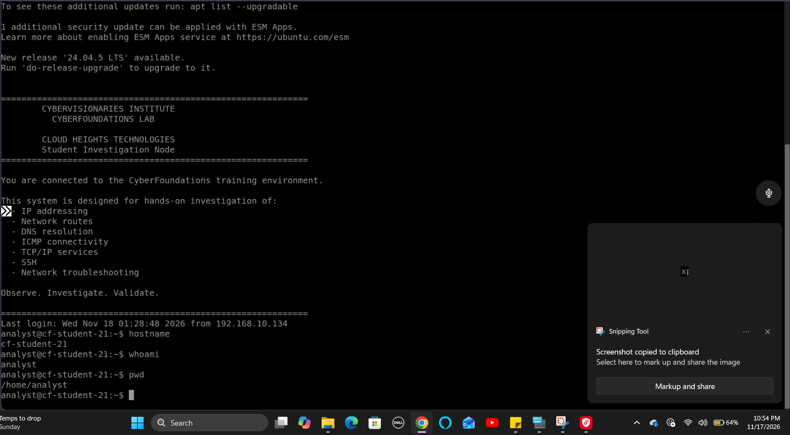

# Week 6 Lab 01 — Claiming Your Room in Cloud Heights

**Student Name:** Chelsie Gotch

**Date Completed:** 11/17/2026

**Module:** 2 — Networking & Cloud Foundations | **Week:** 6  
**Submission Path:** `week-06/labs/lab-01-claiming-your-room.md`

---

> ### 🔒 Cloud Heights Security Rule
> Your Bastion link and Cloud Heights password are **private access credentials**. Never paste either into a worksheet, screenshot, GitHub repository, Circle post, or chat message. When taking screenshots, crop out the browser address bar and all login information.

---

## Overview

Week 5 was practice. This week the machine is real. Cloud Heights is a live Ubuntu 22.04 server running in Azure, and one of its rooms has **already been reserved for you** — you do not create it, provision it, or pay for it. Your job in this lab is to walk in the front door, prove you are standing inside your own room, and understand where that room came from.

This is a **guided** lab. Every step tells you what to do and what to record. Expect 30–40 minutes.

---

## Lab Environment / Pre-Lab Check

| Component | Details |
|---|---|
| Environment | Cloud Heights — live Ubuntu 22.04 VM in Azure, reached through Azure Bastion in your browser |
| Access | Lab Portal → **My Lab Environment** → your Cloud Heights card |
| Username | `analyst` |
| Password | Provided to you separately. Never typed into this worksheet. |
| Commands used | `hostname`, `whoami`, `pwd` |
| Auto-shutdown | Your VM stops automatically after 15 minutes of inactivity. A warning with **Keep Working** appears first. |

**Before you start:** open **My Lab Environment** in the Portal. If your VM shows **Stopped**, click **Start VM** and wait until the status reads **Running** — this takes a minute or two. Only then click **Open Cloud Heights**.

---

## Part A — Walking In

### Step 1 — Start the Room

In **My Lab Environment**, check your Cloud Heights status. Start the VM if it is stopped and wait for **Running**.

The status you saw before you started, and the status you saw after:

```
The status I saw before running the VM showed it was in an unknown state. Once I started the VM the status changed to "Running".
```

### Step 2 — Open Cloud Heights and Sign In

Click **Open Cloud Heights**. A browser-based session opens through Azure Bastion. Sign in with username `analyst` and the password you were given separately.

**Do not record the password, the link, or any part of the login screen anywhere.**

Describe what you saw once the session opened — what kind of screen greeted you:

```
When the VM opened, it immediately loaded a large black command line terminal screen. At the top, I saw the name of the school, CyberVisionaries Institute, and the location listed as CyberFoundations LAB. Lower on the screen, it detailed that I was connected to the training environment and listed the topics I could go over in the VM, such as IP addressing, network routes, and DNS resolution. Below that, it showed the last login details along with my current username prompt.
```

### Step 3 — Ask the Machine Its Name

Run:
```
hostname
```
Output:

```
cf-student-21
```

### Step 4 — Ask Who You Are

Run:
```
whoami
```
Output:

```
analyst
```

### Step 5 — Ask Where You Are Standing

Run:
```
pwd
```
Output:

```
/home/analyst
```

---

## Part B — What Those Three Answers Prove

### Step 1 — Read Them as Evidence

Each of those three commands answered a different question: *which machine*, *which identity*, *which location in the filesystem*. Together they are the proof that you are inside your own room and not somebody else's.

Explain, in your own words, what each output proves:

```
Hostname proves which specific machine or virtual machine I am currently logged into and running commands on. Whoami proves which user account I am using on the system, which matters because every account has different privileges and permissions. Running pwd proves my exact directory path in the file system so I know which folder I am standing in before I start changing or deleting files. All together, these three checks confirm I am the right person, on the right machine, and in the right location, which helps prevent accidental mistakes and security issues.
```

### Step 2 — Capture Your Evidence

Take a screenshot of your terminal showing the three commands and their outputs.

**Required filename:** `bastion-session.png`

**Crop rules — not optional.** The screenshot must show the terminal and prompt. It must **not** show the browser address bar, the Bastion link, any login screen, or any password field. Crop before you upload.

Upload it to `assets/screenshots/week-06/` in your portfolio repository, then paste its link here:



---

## Part C — Where Your Room Came From

### Step 1 — The Golden Image Idea

Every student's Cloud Heights room was built from the **same standardized image** — a known-good snapshot of a configured Ubuntu machine. Nobody hand-built 20 servers. One machine was configured correctly once, captured, and stamped out repeatedly.

Explain in your own words what a standardized (golden) image is and why an organization would build one:

```
A standard golden image is a master template of a fully configured system used to create every student's Cloud Heights VM. It acts as a complete, working copy of how each machine should look and run at the beginning of a lab. An organization builds one because cloning a single proven template is much faster, more consistent, and less prone to human error than configuring dozens of servers manually one by one.
```

### Step 2 — Same Start, Different Rooms

Your room started identical to everyone else's, and from today it starts to diverge as you work in it.

Explain what stays the same across all the rooms and what becomes yours alone:

```
Because every student's virtual machine was created from the same golden image, they'll all start out with the exact same configurations (operating system, installed tools, baseline configurations, network settings, and starting lab files.) From today on, what becomes mine alone is my specific virtual machine instance, my unique user account and home directory, and any new files, folders, command history, or configuration changes I make while working through the labs.
```

---

## Analysis Questions

**Analysis Question 1.** Why does it matter that a standardized image can be *restored*, not just deployed? Describe a realistic situation where restoring from a known-good image is the fastest safe fix. *(Minimum 3 sentences.)*

```
It matters that a golden image can be restored instead of just deployed once because if a computer gets messed up, broken, or infected, you can wipe it back to a clean working copy instead of spending hours trying to fix broken settings one by one. Restoring from that template brings back the whole starting setup cleanly all at once. A good example is if someone accidentally breaks important system settings on a server or gets malware on a work laptop, because the IT team can just reset it back to the clean image in minutes instead of hunting down every single problem.
```

**Analysis Question 2.** Conceptually, how is a snapshot different from a separate backup? Consider what each one protects against and where each one lives. *(Minimum 3 sentences.)*

```
A snapshot is a quick capture of how a virtual machine looks at one point in time, and it exists right next to the virtual machine on the same host drive so you can roll back quikly if you mess something up. A separate backup is a completely different, full copy of your files and system saved in another area like an external drive or off site server. Since a snapshot stays on the same hardware as the virtual machine, it will not save you if that main server crashes, where a separate backup keeps your data safe even if the whole original machine dies.
```

**Analysis Question 3.** Your room was reserved for you rather than created by you. What does that tell you about how cloud access is usually handed out in a real organization, and why would an employer prefer that model? *(Minimum 2 sentences.)*

```
Having a room reserved for me instead of creating it myself shows that in a real job, workers don't just get to spin up whatever cloud machines they want. A company hands out prebuilt, temporary access so they can control who has what and keep everyone following the same security rules without accidentally leaving expensive servers running.
```

---

## Submission Checklist

- [x] VM started from My Lab Environment and confirmed **Running** (Part A, Step 1)

- [x] Signed in through Bastion as `analyst` — no credentials recorded anywhere (Part A, Step 2)

- [x] `hostname`, `whoami`, and `pwd` run and outputs recorded (Part A, Steps 3–5)

- [x] Explained what each of the three outputs proves (Part B, Step 1)

- [x] `bastion-session.png` captured, address bar and login data cropped out, uploaded to `assets/screenshots/week-06/` (Part B, Step 2)

- [x] Standardized/golden image explained in your own words (Part C)

- [x] All three Analysis Questions answered (minimum sentence counts met)

- [x] This file is committed to your portfolio repo at `week-06/labs/lab-01-claiming-your-room.md`

---

## GitHub Commit Subsection

1. Open **Week 6 → Lab 01: Claiming Your Room in Cloud Heights** in the Lab Portal.
2. Fill in the worksheet fields — they match this file, in the same order.
3. Connect your GitHub account if you haven't already, and select your portfolio repo.
4. Click **Submit to GitHub**. The Portal commits the completed file to `week-06/labs/lab-01-claiming-your-room.md`.
5. Upload `bastion-session.png` to `assets/screenshots/week-06/` in your repo before you submit.

---

*CyberVisionaries Institute · Cyber Foundations · Tier I*
